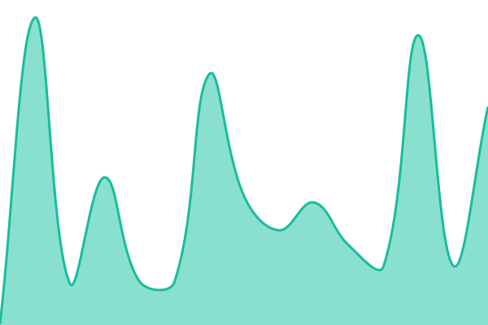

# [📈 Live Status](https://ryan-health.github.io/ryanhealth-statuspage): <!--live status--> **🟩 All systems operational**

This repository contains the open-source uptime monitor and status page for [Ryan Health](https://ryanhealth.org), powered by [Upptime](https://github.com/upptime/upptime).

With [Upptime](https://upptime.js.org), you can get your own unlimited and free uptime monitor and status page, powered entirely by a GitHub repository. We use [Issues](https://github.com/ryan-health/ryanhealth-statuspage/issues) as incident reports, [Actions](https://github.com/ryan-health/ryanhealth-statuspage/actions) as uptime monitors, and [Pages](https://ryan-health.github.io/ryanhealth-statuspage) for the status page.

<!--start: status pages-->
<!-- This summary is generated by Upptime (https://github.com/upptime/upptime) -->
<!-- Do not edit this manually, your changes will be overwritten -->
<!-- prettier-ignore -->
| URL | Status | History | Response Time | Uptime |
| --- | ------ | ------- | ------------- | ------ |
|  [Ryan Health Website](https://ryanhealth.org/) | 🟩 Up | [ryan-health-website.yml](https://github.com/Ryan-Health/ryanhealth-statuspage/commits/HEAD/history/ryan-health-website.yml) | 

 133ms
     
 | 

<a href="https://ryan-health.github.io/ryanhealth-statuspage/history/ryan-health-website">100.00%</a>
    

|  [Web EMR](https://nywrchapp.ecwcloud.com/mobiledoc/jsp/webemr/login/newLogin.jsp) | 🟩 Up | [web-emr.yml](https://github.com/Ryan-Health/ryanhealth-statuspage/commits/HEAD/history/web-emr.yml) | 

 146ms
     
 | 

<a href="https://ryan-health.github.io/ryanhealth-statuspage/history/web-emr">100.00%</a>
    

<!--end: status pages-->

[**Visit our status website →**](https://ryan-health.github.io/ryanhealth-statuspage)

## 📄 License

- Powered by: [Upptime](https://github.com/upptime/upptime)
- Code: [MIT](./LICENSE) © [Anand Chowdhary](https://anandchowdhary.com)
- Data in the `./history` directory: [Open Database License](https://opendatacommons.org/licenses/odbl/1-0/)
